# Lusty Library Installer

Turn a Raspberry Pi into an **offline library**: its own Wi-Fi hotspot that
patrons join to read ebooks, listen to audiobooks and ask for new titles, with
no internet needed.

Supports **Raspberry Pi 3, 4 and 5**, on both the older dhcpcd/hostapd network
stack and the newer NetworkManager stack used by current Raspberry Pi OS.
A **Pi 4 (2 GB or more) or Pi 5 is recommended**. A Pi 3 works, but the ebook
app is slower.

## Original idea

My wife fell in love with reading all over again after our second child was born. Through our oldest child's school, she made some wonderful friends, and together they started a monthly book club.

A little over two years ago, I built what we now call The Lusty Library. It started as a fun little project using a Raspberry Pi 4, an old 500GB SSD, and a whole lot of spaghetti code I wrote myself.

What started as a small project quickly became a huge hit at book club, and now we want to share it with all of you!

I originally wrote all the code myself, but recently used Claude AI to help clean things up and turn it into something much more polished and user-friendly.

The best part? The whole thing is built around a small case from Harbor Freight, a 3D-printed insert and leftover computer parts I had lying around.

It's been a fun project to build, improve, and watch everyone enjoy. I'm excited to finally share The Lusty Library with you!

## What you get

- A **Wi-Fi hotspot** (name, password and IP are yours to choose)
- [Audiobookshelf](https://www.audiobookshelf.org/) for audiobooks and
  [Calibre-Web Automated](https://github.com/crocodilestick/Calibre-Web-Automated)
  for ebooks (new books dropped in the `ingest` folder are added automatically),
  running in Docker, with a shared **patron login** created for you
- A **request page** where patrons ask for a book or audiobook (saved to a CSV
  you can read, with a one-tap "mark fulfilled")
- A **printable welcome sheet** (landscape, one page, also as a PDF) with the
  Wi-Fi details, logins and QR codes
- Optional **auto-sync**: plug in an Ethernet cable and new books and
  audiobooks copy over from another computer or NAS on your network
- Optional **status LEDs** and a **press-and-hold shutdown button** on the
  Pi's GPIO pins

---

## Before you start

- A Raspberry Pi 3, 4 or 5 running Raspberry Pi OS, **connected to your home
  network** (Wi-Fi or Ethernet) with internet access. The install downloads
  Docker and the apps, so it needs the internet.
- A phone or computer on the **same network**, to run the setup wizard.
- Optional: a USB drive for the books, status LEDs and a shutdown button.

## Step 1 - Install

SSH into the Pi (or open a terminal on it) and run:

```bash
curl -sSL https://raw.githubusercontent.com/ryanmnolan/lustylibrary-installer/main/install.sh | sudo bash
```

This installs git, Python and Docker, copies the installer to
`/opt/lustylibrary-installer`, and starts the setup wizard as a service.
The log is at `/var/log/lustylibrary-install.log`.

When it finishes, open the wizard from your phone or computer:

```
http://<pi-ip>:9000/setup
```

`<pi-ip>` is the Pi's address on your home network, for example
`192.168.0.86`. If you don't know it, run `hostname -I` on the Pi.

> **Important:** keep the Pi on your home network until the wizard says it's
> done. The hotspot only starts after the final reboot, so the setup page and
> the internet keep working during the install.

---

## Step 2 - The setup wizard

The wizard has 7 short screens. Use **Next** and **Back** to move around; each
screen checks your answers before letting you continue.

### Screen 1 - Wi-Fi hotspot

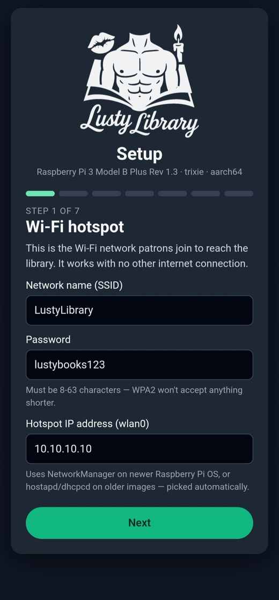

This is the Wi-Fi network patrons will join.

1. **Network name (SSID)** - what patrons see in their Wi-Fi list.
2. **Password** - must be **8 to 63 characters** (a WPA2 rule).
3. **Hotspot IP address** - leave the default (`10.10.10.10`) unless you have
   a reason to change it. This is the address patrons use to reach the library.
4. Tap **Next**.

### Screen 2 - Storage

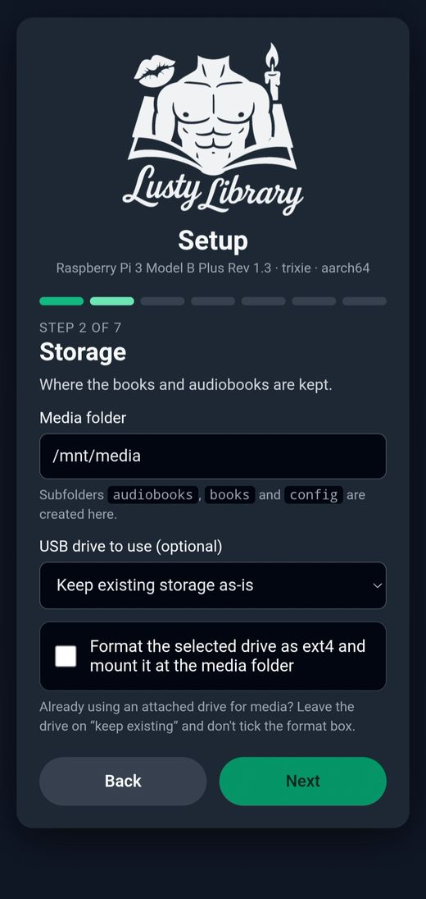

Where the books and audiobooks are kept.

1. **Media folder** - the default `/mnt/media` is fine. The installer creates
   `audiobooks`, `books`, `ingest` and `config` folders inside it.
2. **Drive to use** - each drive you plug in shows up once, with its name and
   size. Pick your SSD or USB drive. The list tells you what will happen:
   - *ready to use, files kept* - the drive already has a Linux (ext4)
     partition, so it is used as it is and nothing is deleted.
   - *will be erased* - the drive is blank or in another format (Windows, for
     example). It is erased and set up for you. **This deletes everything on it.**
   - *Don't use a drive* - keeps everything on the SD card.
3. For a *ready to use* drive, an **Erase this drive and start fresh** box
   appears. Leave it unticked unless you want to wipe the drive.
4. Tap **Next**.

### Screen 3 - Apps

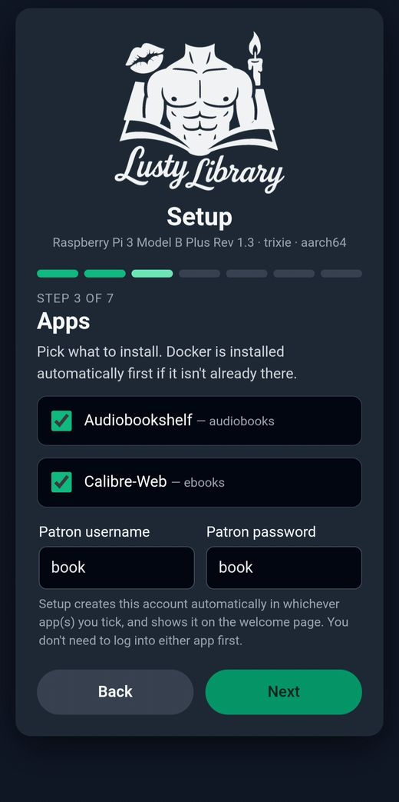

1. Tick **Audiobookshelf** (audiobooks), **Calibre-Web Automated** (ebooks), or both.
   Docker is installed automatically if it isn't already.
2. Choose the **patron username and password**. This one shared login works in
   both apps and is printed on the welcome sheet. The default is `book` /
   `book`.
3. Tap **Next**.

You don't need to log in to either app first; setup creates the account for
you and checks that it really works.

### Screen 4 - Request page

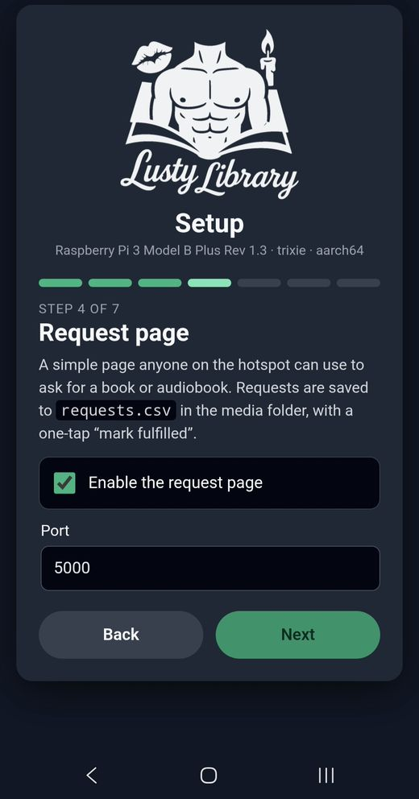

A simple page anyone on the hotspot can use to ask for a book or audiobook.

1. Leave **Enable the request page** ticked to turn it on.
2. **Port** - the default `5000` is fine.
3. Tap **Next**.

Patrons see this (open `http://10.10.10.10:5000` while on the hotspot):

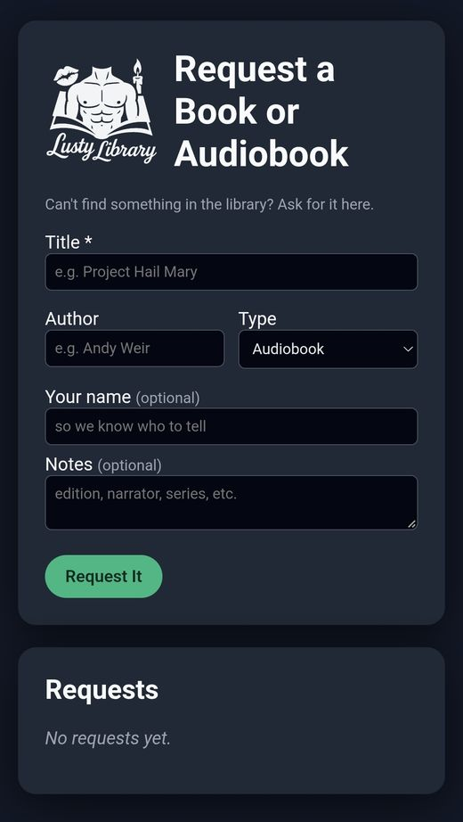

Requests are saved to `requests.csv` in your media folder.

### Screen 5 - Auto-sync (optional)

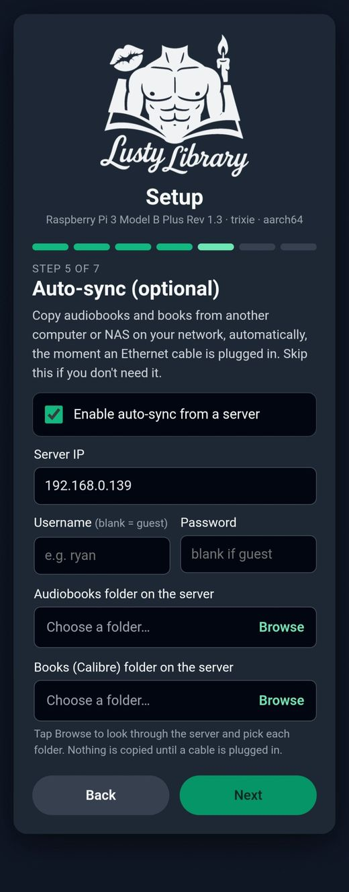

Copies audiobooks and books from another computer or NAS on your network, by
itself, the moment an Ethernet cable is plugged into the Pi. **Skip this
screen** (leave the box unticked) if you don't need it.

1. Tick **Enable auto-sync from a server**.
2. **Server IP** - the address of the computer or NAS that holds your books,
   for example `192.168.0.139`.
3. **Username / Password** - leave both blank if the server allows guest
   access.
4. Under **Audiobooks folder on the server**, tap **Browse**.

   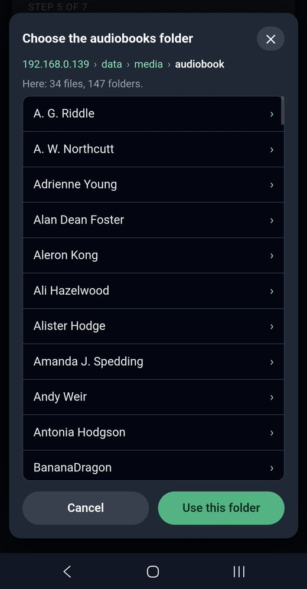

   - The Pi lists the server's shared folders. Tap one to open it, then tap
     into the folders inside it.
   - The path across the top (`192.168.0.139 › data › media › audiobook`)
     shows where you are. Tap any part of it to jump back.
   - When you're in the right folder, tap **Use this folder**.
   - If the server doesn't list its shares, you can type a share name by hand.
5. Do the same for **Books folder on the server**.
6. Tap **Next**.

Notes:

- The first time you tap **Browse**, the Pi installs a small tool (`smbclient`),
  so it needs internet at that moment. It may say "getting ready" for a minute.
- Nothing is copied until an Ethernet cable is plugged in.
- Audiobooks are copied into `audiobooks` on the Pi. Existing files are not
  overwritten.
- Ebooks are copied into the `ingest` folder as plain files (author folders
  are flattened), and the library adds them **by itself**, one at a time.
  Nobody has to scan anything. The folder
  you pick can be loose ebook files or a Calibre library; only the book files
  (epub, mobi, pdf and similar) are used. A book that was already delivered is
  not copied again, even after the library has imported it.
- A book that fails to import is kept in
  `config/calibre/processed_books/failed` for you to look at.

#### The first sync can take a long time

Your first sync copies the whole library, so **be patient: it can take hours,
or even most of a day for a big collection.** This only happens once. Later
syncs only bring the new books and finish in minutes.

- **Audiobooks** are large, so the copy is limited by your network and the
  Pi's drive. Audiobookshelf finds them as they arrive.
- **Ebooks** are copied quickly, but the library then imports them one at a
  time. On a Raspberry Pi that is roughly **two books a minute**, so 600 books
  take around five hours. A Pi 4 or Pi 5 is faster than a Pi 3.
- Books show up **gradually**. The ebook list refreshes by itself every few
  minutes while books are still being imported, so reload the page now and
  then.
- Leave the Pi **powered on, with the Ethernet cable and the drive
  connected**, until it finishes. If it is interrupted, plug the cable in again
  and it carries on. Books already copied are skipped.

To check progress, run these on the Pi:

```
sudo tail -f /var/log/sync_from_server.log      # the sync itself
find /mnt/media/ingest -type f | wc -l          # ebooks still waiting (counts down to 0)
```

The sync is finished when the second number reaches `0`.

### Screen 6 - Hardware (optional)

Only tick these if you have actually wired them to the Pi's GPIO pins. Each one
is tested for real during setup. With nothing ticked, the screen is just two
unticked boxes:

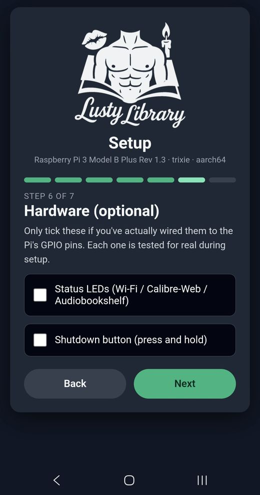

**Status LEDs.** Three LEDs show when each part is ready: green for Wi-Fi,
blue for Audiobookshelf, yellow for Calibre-Web.

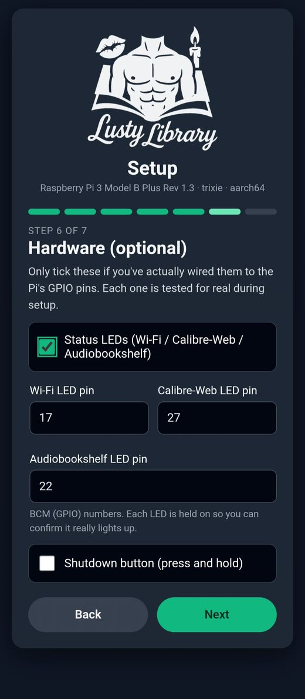

1. Tick **Status LEDs**.
2. Enter the **BCM (GPIO) pin number** for each LED. The defaults are
   Wi-Fi `17`, Calibre-Web `27` and Audiobookshelf `22`. These are GPIO
   numbers, not the physical pin numbers on the header.
3. During setup each LED is switched on so you can confirm it really lights up.

**Shutdown button.** Press and hold to shut the Pi down safely.

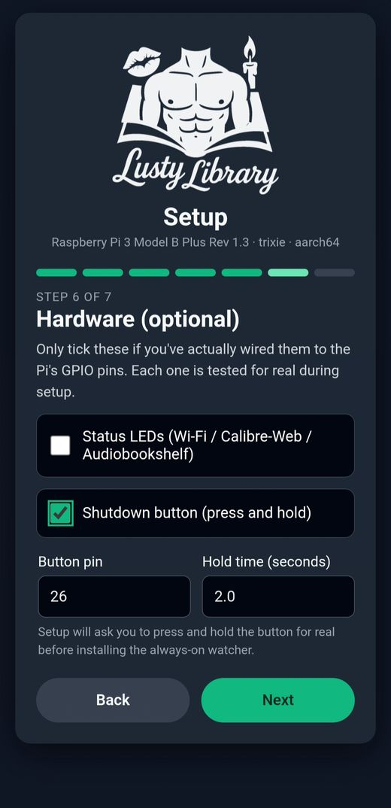

1. Tick **Shutdown button (press and hold)**.
2. **Button pin** - default GPIO `26`. Wire a push button between that pin and
   a ground (GND) pin.
3. **Hold time** - how many seconds it must be held (default `2.0`).
4. During setup you'll be asked to press and hold the button for real before
   the always-on watcher is installed.

Tap **Next**.

### Screen 7 - Review & install

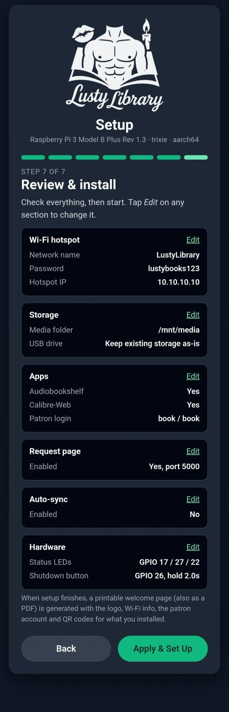

1. Check every section. Tap **Edit** on any of them to go back and change it.
2. Tap **Apply & Set Up** to start.

---

## Step 3 - Installing

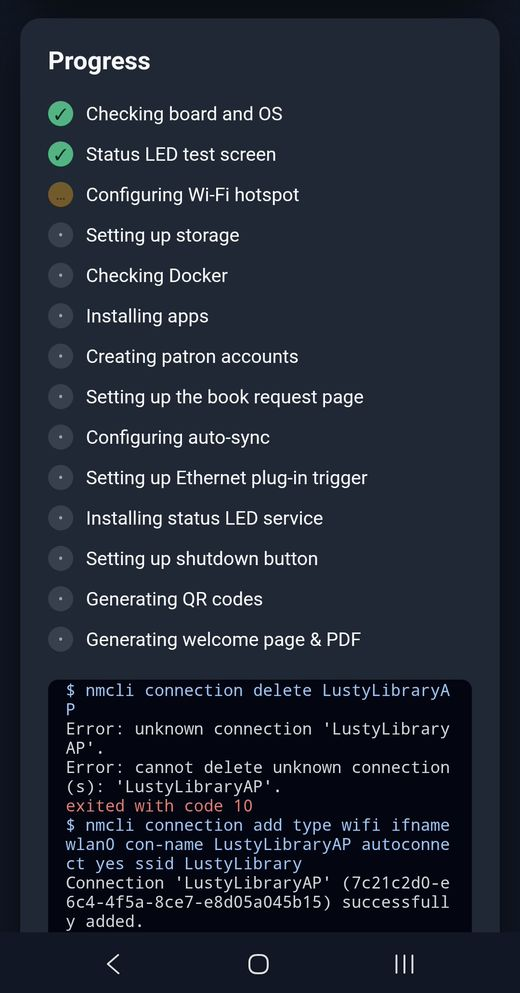

The page switches to a live progress list with a console below it. It takes a
while (Docker images are downloaded), so leave it open. You can ignore the red
`unknown connection 'LustyLibraryAP'` line near the top; on a first install
there is no old hotspot to delete.

If something fails, the step turns red and the console says why. Tap **Change
settings**, fix it and run it again.

## Step 4 - Reboot

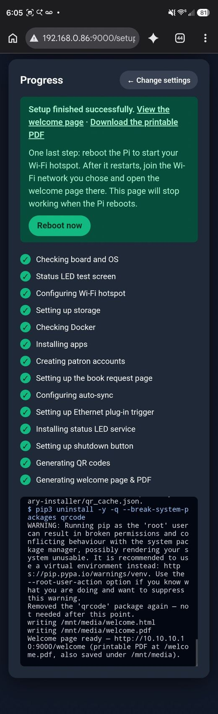

When every step shows a green tick, setup is finished. Tap **Reboot now**
(or run `sudo reboot`). After the restart:

1. The Pi starts the hotspot you chose.
2. On your phone, join that Wi-Fi network (default `LustyLibrary`, password
   `lustybooks123`, unless you changed them).
3. Open the welcome page: `http://10.10.10.10:9000/welcome`.

The setup page stops working at reboot, which is expected.

## Using the library

Once you're on the hotspot (default addresses):

| What | Address | Login |
| --- | --- | --- |
| Ebooks (Calibre-Web) | `http://10.10.10.10:8083` | patron login (`book` / `book` by default) |
| Audiobooks (Audiobookshelf) | `http://10.10.10.10:13378` | patron login |
| Request a title | `http://10.10.10.10:5000` | none |
| Welcome sheet | `http://10.10.10.10:9000/welcome` | none |

For audiobooks, patrons install the free **Audiobookshelf** app on their phone
*before* connecting to the hotspot (the hotspot has no internet), then enter
`http://10.10.10.10:13378` as the server address. The welcome sheet has QR codes
for the iOS and Android apps.

### The welcome sheet

The welcome page is a one-page landscape sheet made to be printed and left next
to the library. Open `/welcome` and tap **Print**, or download the PDF at
`/welcome.pdf`. It also lives in your media folder as `welcome.html` and
`welcome.pdf`. Sections for anything you didn't install are left out.

Here is an example of what it looks like (a real one, made by the installer):


[Download the example PDF](docs/lusty-library-welcome-example.pdf)

---

## Monitor & settings (after setup)

Once the first install has finished, the **setup wizard** is locked behind a password: **`LustyLibrary`**. It's fixed and can't be changed, so treat it as a guard against accidental clicks, not real security. The **Monitor** and **Settings** pages are open to anyone on the Lusty Library Wi-Fi or your home network at `http://10.10.10.10:9000/monitor` (and `/settings`). The welcome sheet (`/welcome`) is public too.

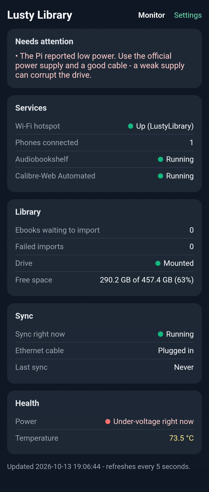

- **Monitor** refreshes every 5 seconds and shows: whether the Wi-Fi hotspot is up (and how many phones are connected), whether Audiobookshelf and Calibre-Web Automated are running, whether a sync is running, ebooks and audiobooks in the library, ebooks waiting to import (including ones still being copied from your server during a long first sync), failed imports, free space on the drive, power (low-voltage warnings), temperature, and the last sync time and result. A "Needs attention" box lists anything wrong.
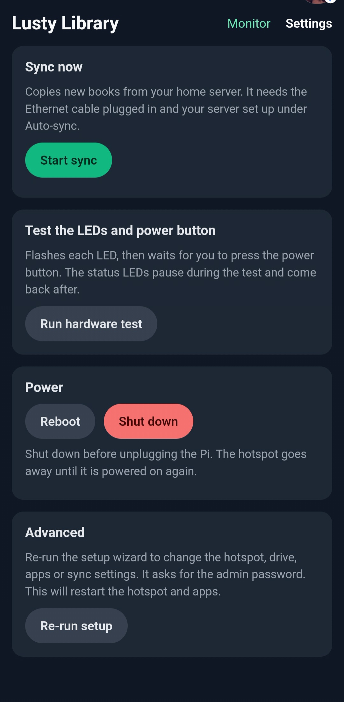

- **Settings** has a **Start sync** button (needs the Ethernet cable plugged in, and says so if it isn't), a **hardware test** that flashes each LED and waits for a power-button press (the LED and button services pause during the test and restart afterwards), **Reboot** and **Shut down** buttons, and **Re-run setup** (asks for the password) to change the hotspot, drive, apps or sync settings.

## Case & 3D print

A 3D-printable insert for the LEDs, the shutdown button and an RJ45 keystone
jack is available on Printables:

> **Printables link: coming soon.**

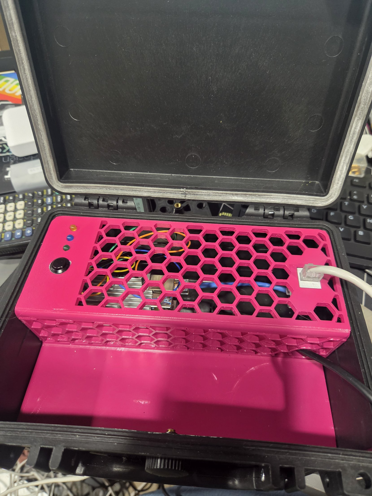

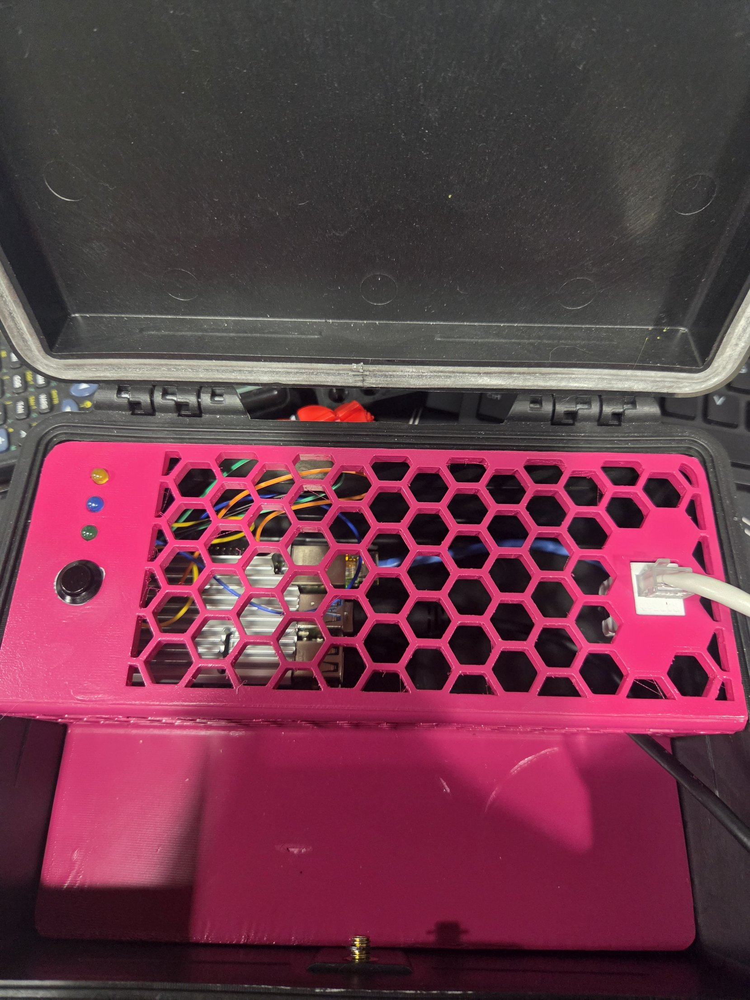

The insert is made for one case, and it doesn't fit any other. It is sized for
the **APACHE 1800 Weatherproof Protective Case, Small, Black**
([Harbor Freight product page](https://www.harborfreight.com/1800-weatherproof-protective-case-small-black-64550.html)).
It has three 5 mm LED holes, a hole for a 12 mm push button, and an opening for
an RJ45 keystone jack. I printed it in three parts and fused them together with
a soldering iron. Print settings: PLA, 20% infill.

### Parts list

| Qty | Part | Notes |
|-----|------|-------|
| 1 | APACHE 1800 case | Linked above |
| 3 | [5 mm LEDs](https://a.co/d/02wJoa7X) | One green, one yellow, one blue (matches the welcome sheet) |
| 3 | [330 ohm resistors](https://a.co/d/0ilPnb2c) | One per LED |
| 1 | [12 mm momentary push button](https://a.co/d/0ajX9YHT) | The safe-shutdown button |
| 1 | RJ45 keystone jack | Lets you plug the network cable in from outside the case |
| - | Jumper wires, solder | To connect the LEDs and button to the Pi's header |

The LEDs and the button are optional. Turn them on in the wizard's Hardware screen.

All the parts are on this [Amazon wish list](https://www.amazon.com/hz/wishlist/ls/2Z6XI66JNRJ7T?ref_=wl_share).

## Wiring (optional hardware)

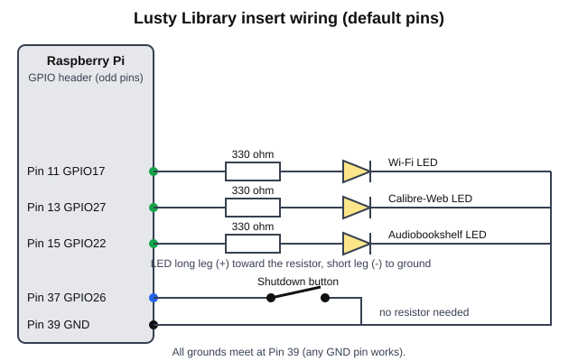

These are the default pins. You can change them in the wizard's Hardware screen.

| Part | Pi pin | GPIO | Goes to |
|------|--------|------|---------|
| Green LED (Wi-Fi is ready) | 11 | GPIO17 | resistor, then LED long leg (+) |
| Yellow LED (ebooks are ready) | 13 | GPIO27 | resistor, then LED long leg (+) |
| Blue LED (audiobooks are ready) | 15 | GPIO22 | resistor, then LED long leg (+) |
| Shutdown button | 37 | GPIO26 | one side of the button |
| Ground | 39 (any GND pin) | - | every LED short leg (-) and the other side of the button |

- **LEDs:** each LED's long leg goes to its GPIO pin through a 330 ohm resistor,
  and its short leg goes to ground. A lit LED means that service is up. This matches the
  welcome sheet: green = Wi-Fi is ready, blue = audiobooks are ready, yellow =
  ebooks are ready.
- **Shutdown button:** one side to GPIO26, the other side to ground. No resistor
  is needed. Hold the button for about two seconds to shut the Pi down safely.
- To check your wiring outside the wizard, run
  `sudo python3 /opt/lustylibrary-installer/gpio_diagnostic.py`.

## Uninstall

```bash
sudo bash /opt/lustylibrary-installer/uninstall.sh                # keep library data
sudo bash /opt/lustylibrary-installer/uninstall.sh --purge-data   # wipe it too
sudo bash /opt/lustylibrary-installer/uninstall.sh --full         # remove everything, incl. Docker
```

## Updating

```bash
cd /opt/lustylibrary-installer
sudo git pull
sudo systemctl restart lustylibrary-setup
```

## Troubleshooting

| Problem | What to do |
| --- | --- |
| The setup page won't load | Check the service: `sudo systemctl status lustylibrary-setup`. Make sure your phone is on the same network as the Pi and you used port `9000`. |
| "Password must be 8-63 characters" | Pick a longer Wi-Fi password (WPA2 needs at least 8). |
| I can't see the hotspot after setup | Reboot the Pi. The hotspot starts on the next boot. |
| The page froze during the install | Leave it. Reload `http://<pi-ip>:9000/setup`; it reconnects to the running install. |
| Patron login doesn't work | Setup checks the login at the end. If the step shows an error, create the user in Calibre-Web as `admin` / `admin123` (Admin, then Add new user). |
| Folder browser says it can't reach the server | Check the server IP, that the server is on the same network, and the username and password. |
| The ebook library is empty or only shows a few books | Normal during the first big sync. Books are imported one at a time and the list refreshes every few minutes. Check `find /mnt/media/ingest -type f \| wc -l`; while that number is going down, it is working. See [the first sync can take a long time](#the-first-sync-can-take-a-long-time). |
| "Undervoltage detected" in `sudo dmesg`, or the drive drops out | The Pi is not getting enough power. Use the official Raspberry Pi power supply (5.1V, 3A) and a good cable, or put the SSD on a powered USB hub. |
| A step failed | Read the console on the progress page and `/var/log/lustylibrary-install.log`, fix the cause, then use **Change settings** and run it again. |

## Files

| File | Purpose |
| --- | --- |
| `install.sh` | One-line installer |
| `setup_gui.py` | The setup wizard (Flask app on port 9000) |
| `uninstall.sh` | Removes what the installer added |
| `gpio_diagnostic.py` | Tests LED and button wiring |
| `lustylibrary-setup.service` | systemd unit for the wizard |
